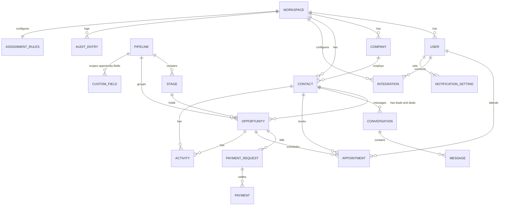

# Data model

Every table carries `workspaceId` and is scoped by it on every query (F1.6, Q2).

## ERD

## Entities

| Entity | Purpose | Key fields | Requirement refs |
|---|---|---|---|
| `Workspace` | Isolated tenant; owns everything | name, slug | F1.6, Q6 |
| `User` | Member of a workspace | name, email (unique per workspace), passwordHash (argon2), role, permissions (JSON array, overrides preset), employeeStatus, notificationTarget | F1.1–F1.3, F3.2, I4.3 |
| `Company` | Account/organization | name, domain, phone, address | F2.1 |
| `Contact` | Person | name, email, phone, companyId, ownerId, tags, customFields (JSON), optedOut | F2.1, I1.9 |
| `Pipeline` | One customizable pipeline (F2.3 allows more) | name, isDefault | F2.5 |
| `Stage` | Ordered pipeline column | name, order, isWon, isLost, requiredFieldKeys (JSON) | F2.4, F2.5 |
| `CustomFieldDefinition` | Admin-created field | entity (contact/opportunity), pipelineId (nullable), key, label, type, options, required, order | F2.2, F2.3 |
| `Opportunity` | Deal; also the lead record | title, contactId, companyId, pipelineId, stageId, value (Decimal), currency, ownerId, source, customFields, assignedAt, acknowledgedAt, ackDeadlineAt, escalationCount, stageEnteredAt, lastActionAt | F2.x, F3.x |
| `SavedList` | Persisted filter combination | entity, name, filter (JSON) | F2.6 |
| `Activity` | Timeline entry on contact/opportunity | entityType, entityId, type, actorId (null = system), summary, meta (JSON) | F2.7 |
| `AssignmentRules` | One per workspace | mode, maxOpenLeadsPerUser, ackWindowSeconds, escalationLevels (JSON), backupUserId, managerUserId, idleThresholdSeconds | F3.3–F3.6 |
| `Conversation` | All messages with one contact on one channel | contactId, channel, assignedUserId, lastMessageAt, unreadCount | I1.6 |
| `Message` | One message | conversationId, direction, body, status, providerMessageId (unique), errorCode, errorMessage | I1.1–I1.8 |
| `ProviderEvent` | Idempotency + sync history | provider, externalId (unique), direction, eventType, payload, result, errorMessage, at | I1.8, I2.4, I5.4 |
| `PaymentRequest` | Link/checkout for an opportunity | opportunityId, contactId, amount, currency, status, providerRef, checkoutUrl, requestedByUserId | I2.1, I2.5, I2.7 |
| `Payment` | Confirmed money movement | paymentRequestId, amount, currency, status, providerRef, paidAt, refundedAmount | I2.2–I2.6 |
| `Appointment` | Calendar event | contactId, opportunityId, userId, title, startsAt, endsAt, timeZone, status, googleEventId, syncState | I3.3–I3.7 |
| `Integration` | Per-workspace provider connection | provider, status, encryptedCredentials, accountLabel, lastSuccessAt, lastErrorAt | I5.1–I5.7 |
| `AuditEntry` | Immutable action log | actorId (null = system), actorType, eventType, targetType, targetId, before (JSON), after (JSON), at | F4.1–F4.3 |
| `NotificationSetting` | Per-user alert destination | userId, channel, destination | I4.3 |

## Rules

- **No hard deletes of history**: audit entries are append-only (F4.3). Deleting a stage with opportunities requires moving them first (F2.5); deleting a custom field keeps its values in `customFields` untouched but hides the definition — a documented, safe behavior.
- **Stage deletion**: blocked unless empty, or requires `moveToStageId` in the request; blocked response uses `conflict` with `details.reason`.
- **Unique constraints**: `Message.providerMessageId`, `Payment.providerRef`, `ProviderEvent(provider, externalId)`, `User.email` per workspace, `CustomFieldDefinition(workspaceId, entity, pipelineId, key)`.
- **Indexes**: every list endpoint's filter combination (workspaceId + ownerId/stageId/status), `ackDeadlineAt` for timers, `at` on audit.
- **Soft state, never orphaned**: deleting a user reassigns their open leads via the assignment rules before removal (Q4).
